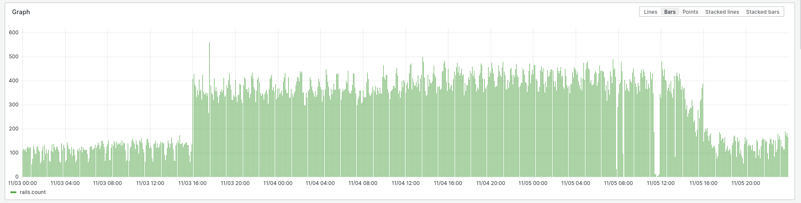
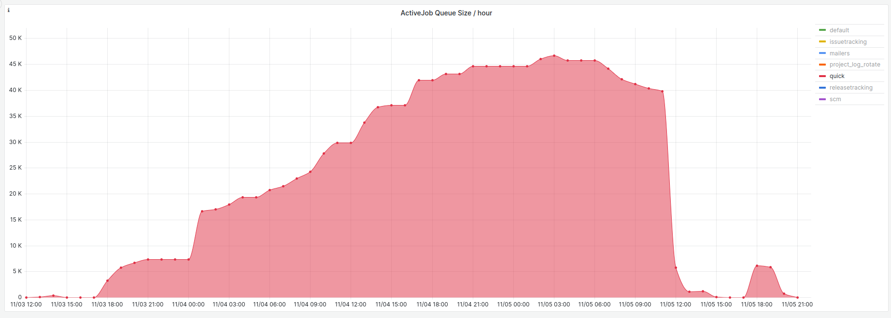

On November 5th, the OBS experienced a severe service disruption. A large backlog of background jobs piled up,
and the measures taken to work through the backlog ended up overloading our system. As a result, build.opensuse.org
was unable to process any request for roughly 40 minutes.

We want to share what happened, how we mitigated the failure, and the steps we are taking to avoid similar disruptions in the future.

## Detection

Our monitoring raised an alert about not enough throughput. Shortly afterwards connections from the application server
to the database started failing and many other alerts started to fire.

## Root Cause

Starting the evening of November 3 we experienced a(nother) DDoS to our request page.

This attack lead to a high amount `BsRequestActionWebuiInfosJob` in our background job queue.

To process the backlog faster we doubled the amount of workers for this queue. The additional workers caused a significant
increase in load on a backend server. The system eventually ran out of memory (OOM) and took the OBS backend with it.

Additionally the resulting stream of failed database connections caused our cluster to block the application host entirely,
no new database connections could be established.

## Resolution

1. Removed all pending `BsRequestActionWebuiInfosJob` jobs from the queue
2. Scale down the background job queue to its original size
3. Restarted the overloaded hosts
4. Flush all cached hosts on the database

### Action Items

We have created some follow-up action items:

| Action Item | Owner |
|---          |---    |
| [Limit the amount of low prio BsRequestActionWebuiInfosJob](https://github.com/openSUSE/open-build-service/pull/20647]) | Developer Team |
| [More ActiveJob Queue alerts](https://trello.com/c/nyC5ombv) | Developer Team |
| [Anonymous Traffic Alert](https://trello.com/c/VXceVjrN) | Developer Team |

## Lessons Learned

Scaling up a background job queue does not only have an impact on the host running the queue workers but also on all all hosts
involved in processing the jobs. Any increase in the number of delayed job queues should take the systems capacity into account
and be done gradually while watching system utilization.

## Timeline (All Time in UTC)

- 2026-11-03 16:00: DDoS starts...
- 2026-11-04 12:50: First customer complained about a page not working that relied on `BsRequestActionWebuiInfosJob`
- 2026-11-04 17:21: One of us alerted everyone that we've got a constantly growing background job queue
- 2026-11-05 11:10: We started one more worker for the overloaded queue
- 2026-11-05 11:13: We started 4 additional workers for the overloaded queue, scaling up the queue from 4 to 9 workers.
- 2026-11-05 11:25: Received the first automated alert about the system not being able to process requests anymore .
- 2026-11-05 11:26: Incident officially declared.
- 2026-11-05 11:38: Reduced the number of delayed job queues from 9 to 8.
- 2026-11-05 11:40: Reduced the number of delayed job queues from 8 to 7.
- 2026-11-05 11:42: Reduced the number of delayed job queues from 7 to 6.
- 2026-11-05 11:44: Database connections failing; MariaDB blocked the application host due to too many connection errors.
- 2026-11-05 11:45: We stopped all support processes
- 2026-11-05 11:54: Restarted our web server
- 2026-11-05 11:57: We started all support processes
- 2026-11-05 12:05: We removed all  `BsRequestActionWebuiInfosJob` from the delayed job queue
- 2026-11-05 12:06: Reduced the number of delayed job queues from 6 to 4.
- 2026-11-05 12:11: We declared the incident as resolved.
