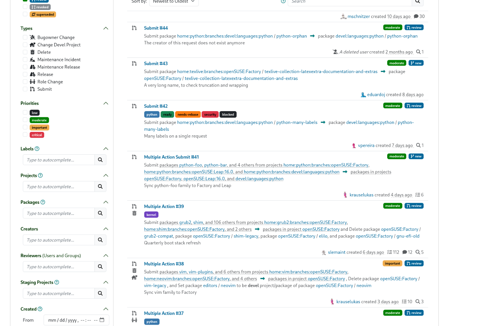
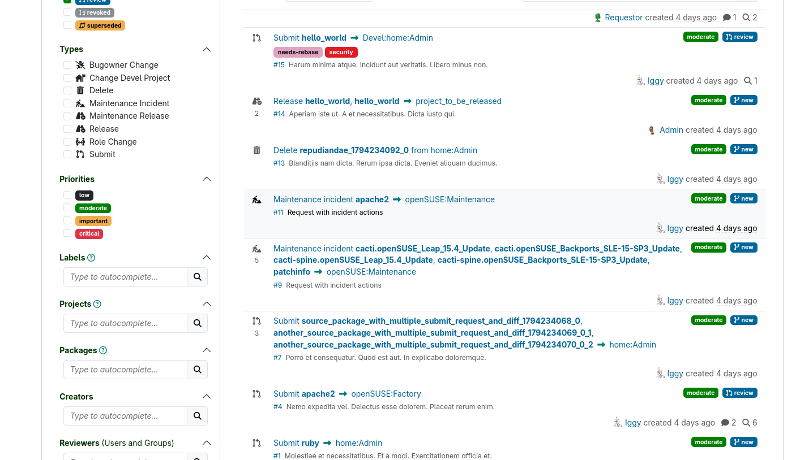

In our latest sprint, we focused on improving the usability of the requests list. The main goal of this page is simple: show just enough relevant information so you can recognize a single request at a glance and jump right into it. Here is what we identified and how we cleaned it up.



### What Changed

At first glance, you can notice a reduction in visual noise in the request list before and after the changes we have just introduced.

<figure>
  
  <figcaption>Request list before revamping</figcaption>
</figure>

<figure>
  
  <figcaption>Request list after revamping</figcaption>
</figure>

To make the list easier to scan, we stripped out redundant labels and summarized the details without hiding what matters:

- Removed redundant wording: Dropped the word "Request" which was repeated across every single item. Since you are already on the requests list, this added unnecessary eye-pollution without giving you any useful context

- Shorter, clearer titles: Trimmed submit request titles down to `sourcePackage → targetProject`, highlighting the key information immediately.

- Better summaries for multi-action requests: Condensed long descriptions and oversized tooltips, adding a clearer preview of mixed action types so you can quickly grasp both the volume and variety of actions inside a request.

- Use self-explaining icons: drop the words "comments" and "reviews" to label their counts, the icons identify them clearly.

When you're dealing with tons of requests in your daily work, it can be hard to know where to start. You can now use the new sorting options in the top dropdown menu: `Most Actions` and `Least Actions`.

Give the updated list a try and let us know what you think!


